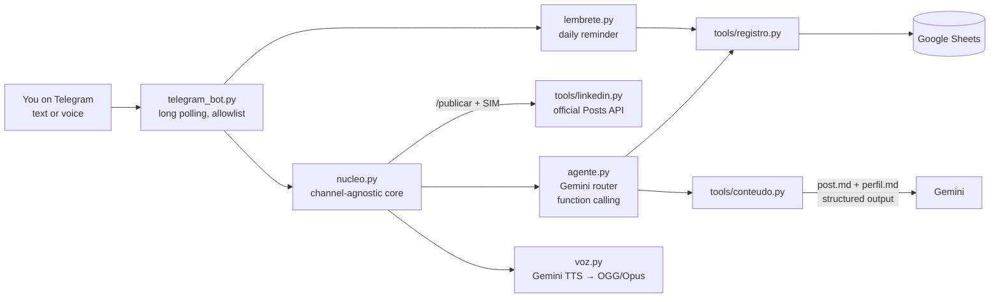

# Ultron: a personal AI agent for LinkedIn career routines

> 🇧🇷 [Leia em português](README.pt-BR.md)

Ultron is a personal AI agent that runs a LinkedIn growth routine end to end. It logs daily activities from text or voice notes and tracks weekly goals in Google Sheets. It also turns spoken insights into post drafts and publishes approved posts through the official LinkedIn API. It is used daily through a Telegram bot, with voice replies.

## What it does

- **Logs the day by voice or text.** "Today I sent 25 invites, 18 to recruiters, and wrote 3 comments" becomes a row in the tracking sheet. "Actually it was 20" corrects it, and "10 more invites" adds to it.
- **Reports weekly performance** against goals, leading with what is furthest behind.
- **Reminds you in the evening** when nothing was logged that day (configurable time).
- **Turns a voice note into a post draft** based on your professional profile. A strict faithfulness rule applies: it never invents metrics, and anything missing or generalized is flagged for review.
- **Revision loop:** adjust, review, approve or discard the draft through chat. The draft is saved to disk and survives bot restarts.
- **Publishes to LinkedIn** via the official API, only after an explicit two-step confirmation.
- **Replies with voice** (Gemini TTS), with captions for quick reading.

## Architecture



## Design decisions

**Human in the loop for irreversible actions.** Publishing is not exposed to the model as a tool. It only happens through the `/publicar` command followed by an explicit "SIM". Any other reply cancels publishing. If that reply is a new message, such as a voice note or a daily log, it goes on to the agent instead of being lost.

**Compliant with LinkedIn's terms.** LinkedIn offers no API for sending invitations or commenting on other people's posts, and browser automation for that violates its User Agreement. Ultron does the thinking work (drafts, notes, tracking) and leaves those clicks to you.

**Hallucination guardrails.** The post prompt puts faithfulness over style. Missing information goes into an `alerts` field instead of being made up.

**No personal data in the code.** The name comes from `.env`. The professional profile and the example post live in local files kept out of Git (`prompts/perfil.md`, `prompts/exemplo_post.md`).

**Deterministic display.** Drafts are printed by code from a buffer, not relayed by the router model.

**Spreadsheet math instead of lookups.** Each day's row is computed as `5 + (date - start).days`, so it does not depend on locale-specific date parsing.

**Resilience and idempotency.** Transient errors are retried with exponential backoff, with a switch to a fallback model. If a model fails after a tool already wrote something, you get a code-generated summary of what was done and nothing is duplicated.

## Running it

1. `py -3.12 -m venv .venv`, then `.venv\Scripts\pip install -r requirements.txt`.
2. Copy `.env.example` to `.env` and fill in the keys.
3. Copy `prompts/perfil.exemplo.md` to `prompts/perfil.md` and write your profile. Optionally, put one of your posts in `prompts/exemplo_post.md` as a voice reference.
4. Create the spreadsheet (layout in the Portuguese README) and share it with the service account email.
5. `python linkedin_auth.py` once to authorize publishing (the token lasts about 60 days).
6. `python telegram_bot.py`, or `python cli.py` for the terminal.

## Tests

```
.venv\Scripts\pip install -r requirements-dev.txt
.venv\Scripts\python -m pytest
```

Tests run offline, without real keys.

## Author

**Luiz Arthur**, data engineer.
[LinkedIn](https://www.linkedin.com/in/luiz-arthur-/) · [GitHub](https://github.com/ArthurTheWorld)
