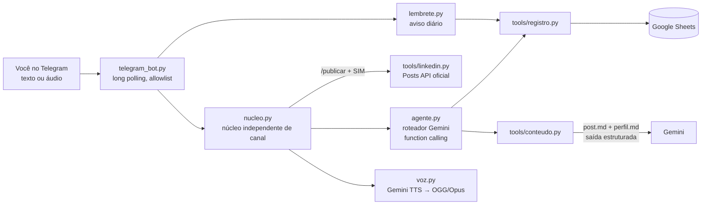

# Ultron: agente de IA pessoal para a rotina de carreira no LinkedIn

> 🇺🇸 [Read in English](README.md)

O Ultron é um agente de IA pessoal que cuida de ponta a ponta de uma rotina de crescimento no LinkedIn. Ele registra as atividades do dia a partir de texto ou áudio e acompanha metas semanais no Google Sheets. Também transforma aprendizados falados em rascunhos de post e publica os aprovados pela API oficial do LinkedIn. O uso diário é por um bot no Telegram, com respostas em voz.

## O que ele faz

- **Registra o dia por voz ou texto.** "Hoje mandei 25 convites, 18 para recrutadores, e fiz 3 comentários" vira uma linha na planilha. "Na verdade foram 20" corrige, e "mais 10 convites" soma.
- **Mostra a performance da semana** frente às metas, começando pelo que está mais atrasado.
- **Lembra você à noite** se nada foi registrado no dia (horário configurável).
- **Transforma um áudio em rascunho de post**, com base no seu perfil profissional. A regra de fidelidade é rígida: ele nunca inventa métricas, e o que falta ou foi generalizado aparece sinalizado para revisão.
- **Ciclo de revisão:** ajustar, rever, aprovar ou descartar o rascunho pelo chat. O rascunho fica salvo em disco e sobrevive a reinícios do bot.
- **Publica no LinkedIn** pela API oficial, só depois de uma confirmação explícita em duas etapas.
- **Responde em voz** (TTS do Gemini), com legenda para leitura rápida.

## Arquitetura



## Decisões de design

**Humano no loop para ações irreversíveis.** Publicar não é uma ferramenta disponível para o modelo. Só acontece pelo comando `/publicar` seguido de um "SIM" explícito. Qualquer outra resposta cancela a publicação. Se a resposta for uma mensagem nova, como um áudio ou um relato do dia, ela segue para o agente e não se perde.

**Em conformidade com os termos do LinkedIn.** O LinkedIn não oferece APIs para enviar convites ou comentar em posts de terceiros, e automatizar o navegador para isso viola o Contrato do Usuário. O Ultron faz o trabalho de pensar (rascunhos, notas, acompanhamento) e deixa esses cliques com você.

**Proteção contra alucinação.** O prompt de posts prioriza fidelidade sobre estilo. Informação faltante vai para o campo `alertas`, em vez de ser inventada.

**Prompts sem dados pessoais no código.** O nome vem do `.env`, e o perfil profissional e o post de exemplo ficam em arquivos locais fora do Git (`prompts/perfil.md`, `prompts/exemplo_post.md`).

**Exibição determinística.** Os rascunhos são mostrados pelo código a partir de um buffer, e não repassados pelo modelo roteador.

**Aritmética em vez de busca na planilha.** A linha de cada dia é calculada como `5 + (data - início).days`, sem depender do formato de data da localidade.

**Resiliência e idempotência.** Erros temporários são repetidos com espera exponencial, e há troca para um modelo reserva. Se o modelo cai depois de uma ferramenta já ter gravado algo, você recebe um resumo do que foi feito e nada é duplicado.

## Como rodar

1. `py -3.12 -m venv .venv` e depois `.venv\Scripts\pip install -r requirements.txt`.
2. Copie `.env.example` para `.env` e preencha as chaves.
3. Copie `prompts/perfil.exemplo.md` para `prompts/perfil.md` e escreva o seu perfil. Opcional: coloque um post seu em `prompts/exemplo_post.md` como referência de voz.
4. Crie a planilha (layout abaixo) e compartilhe com o e-mail da service account.
5. `python linkedin_auth.py` uma vez, para autorizar a publicação (o token dura cerca de 60 dias).
6. `python telegram_bot.py`, ou `python cli.py` para usar no terminal.

Para iniciar sozinho no login do Windows, rode `instalar_tarefa.ps1`. Para parar, rode `parar_ultron.ps1`. Os logs ficam em `logs/ultron.log`.

### Layout da planilha

| Aba | O que o Ultron lê ou grava |
|---|---|
| `Config` | `C4`: data de início do desafio |
| `Registro Diário` | uma linha por dia a partir da 5 (84 dias). Colunas `D:M`: rotina feita (S/N), posts, convites, convites a recrutadores, convites aceitos, comentários, ações de relacionamento, conversas iniciadas, minutos de inglês, observações |
| `Metas Semanais` | linha 3: metas; linhas 5 a 16: semanas 1 a 12, colunas `A:T` |

## Testes

```
.venv\Scripts\pip install -r requirements-dev.txt
.venv\Scripts\python -m pytest
```

Os testes rodam sem rede e sem chaves reais.

## Próximos passos

- CRM de contatos no Sheets: quem conectar, por quê, status e lembretes de follow-up
- Conjunto de avaliação para medir qualidade e fidelidade dos rascunhos entre modelos
- Deploy na nuvem (Cloud Run), com o estado fora do disco local
- Canal de WhatsApp sobre o mesmo núcleo

## Autor

**Luiz Arthur**, engenheiro de dados.
[LinkedIn](https://www.linkedin.com/in/luiz-arthur-/) · [GitHub](https://github.com/ArthurTheWorld)
